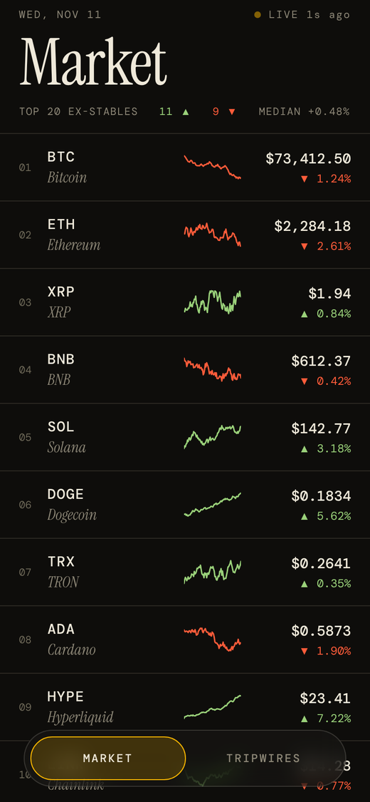
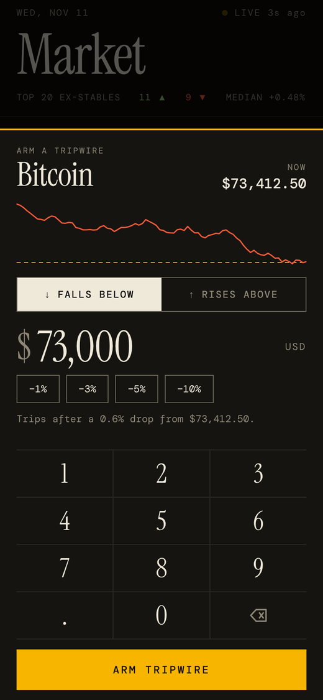
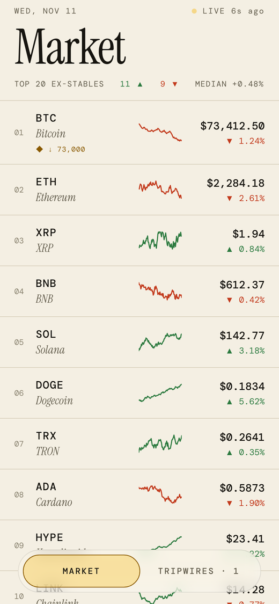

# Tripwire

Crypto price alerts for your pocket. Watch the top coins, set a price, get a notification when it trips.
Example: *"tell me when BTC falls below $73,000."*

Built with Expo SDK 58, React Native 0.88 and TypeScript. Prices come from CoinGecko, in USD.

<p>
  
  
  
</p>

*Browser previews with sample prices. The tab bar shows the blur fallback; native Liquid Glass needs an iOS 26+ phone.*

## Run it

```bash
npm install
npx expo start
```

Scan the QR code with Expo Go. Expo Go for the app stores supports one SDK at a time, so if it says the
project is incompatible, check which SDK your Expo Go version targets.

On a **physical iPhone**, Expo Go also needs you signed in to the *same* Expo account in the terminal
(`npx expo login`) and in the Expo Go app.

## Alerts while the app is fully closed

A phone can't be trusted to watch prices once you swipe the app away: iOS treats that as "don't run this app"
and doesn't document what background work, if any, still happens afterwards. What iOS *does* still deliver is a
visible push notification. So a small server watches the prices and pushes through Expo. Expo Go on iOS can receive these, so there is no development build and no Apple
Developer account involved (Expo Go on Android can't receive remote push since SDK 53).

The server is in `server/`: a Cloudflare Worker with a cron schedule and a D1 database.

**1. Give the app an EAS project ID.** Free, and it must be the Expo account Expo Go is signed in to. If you
cloned this repo, first delete the original author's `owner`, `extra.eas.projectId` and `updates` entries from
`app.json`. The command below asks you to sign in, then writes your own ID into `app.json`:

```bash
npx eas-cli init
```

**2. Set up the server.** One command signs you in to Cloudflare (in your browser; a free account is fine),
creates the database, deploys the Worker, sets its keys and writes the two `EXPO_PUBLIC_TRIPWIRE_*` lines into
`.env` for you. It is safe to run again, and re-running keeps your existing key.

```bash
cd server
npm install
npm run setup
```

<details>
<summary>The same thing by hand</summary>

```bash
npx wrangler login
npx wrangler d1 create tripwire          # paste the database_id it prints into wrangler.toml
npx wrangler d1 execute tripwire --remote --file=schema.sql
npx wrangler deploy                      # prints https://tripwire.<you>.workers.dev
npx wrangler secret put API_KEY          # any long random string
npx wrangler secret put COINGECKO_KEY    # optional: a free CoinGecko Demo key
```

Then copy `.env.example` to `.env` and fill in `EXPO_PUBLIC_TRIPWIRE_API` (the Worker address) and
`EXPO_PUBLIC_TRIPWIRE_KEY` (the same `API_KEY`). Deploy before setting secrets: `wrangler secret put` on a Worker
that doesn't exist yet stops to ask whether to create one.

</details>

**3. Restart the app** with `npx expo start -c` so it picks up `.env`.

**4. Prove it.** Arm a tripwire (allow notifications when asked). Open Tripwires → Coverage; it should say
the server is connected. Tap **Send test alert**, then fully close Expo Go. A push arrives in about 10 seconds.

How it fits together:

- The app syncs its tripwires to the server whenever they change and every time prices refresh.
- Every 5 minutes (`crons` in `server/wrangler.toml`) the Worker prices each coin that has an armed
  tripwire, sends a push for each one that crossed, and only then marks it tripped. A failed send is
  retried on the next tick: a rare duplicate beats a lost alert.
- When the app is open it still checks every minute itself and fires instantly. It syncs *before* checking,
  so a tripwire the server already fired isn't fired again.
- The app and server never trip the same wire twice: a trip is permanent on both sides.

Things to know:

- **Cadence.** CoinGecko's Demo plan allows 10,000 calls a month. One check every 5 minutes is about 8,600,
  so that is the default. Every minute is about 43,000, which needs a paid plan or a different price feed
  (`fetchPrices` in `server/src/core.ts` is the one place to change). Put the Demo key on the server only
  and leave the app keyless, so the two don't share the quota.
- **The key in `.env` ships inside the app, and inside any update you publish.** Treat it as public. It only
  deters casual use of your Worker; it isn't a real secret.
- **Tapping the notification** opens Tripwire on the Tripwires tab in a real build. Expo Go still opens Expo Go and
  needs your dev server running (or a published update) to load. See [docs/ios-build.md](docs/ios-build.md) for the
  iPhone build steps.
- If registering a push token ever fails in Expo Go, the fallback is a development build, which needs an
  Apple Developer account on iOS.
- Run the server's tests with `cd server && npm test`.

## What it costs

Nothing, for personal use. Everything runs on free tiers:

| Piece | Free allowance | What Tripwire uses |
| --- | --- | --- |
| Cloudflare Workers | 100,000 requests a day, 10 ms CPU per request, 5 cron triggers per account | about 290 checks a day, plus one request a minute while the app is open |
| Cloudflare D1 | 5 million rows read and 100,000 rows written a day | a handful of rows per check; a sync writes nothing unless a wire changed |
| CoinGecko Demo plan | 10,000 calls a month | about 8,600 a month at one check every 5 minutes |
| Expo account | free (needed for the project ID) | one project |

Free daily limits reset at 00:00 UTC; past them Cloudflare returns errors until the reset rather than billing you.
Limits change, so check Cloudflare's [Workers limits](https://developers.cloudflare.com/workers/platform/limits/)
and [D1 pricing](https://developers.cloudflare.com/d1/platform/pricing/).

## How alerts work

| App state | What happens |
| --- | --- |
| Open | Prices refresh every minute (`POLL_MS` in `src/hooks/useMarket.ts`). Crossing a target fires a local notification immediately. |
| Closed, server set up | The Worker checks on its schedule and pushes through Expo. Works after a force-quit. |
| Closed, no server | A background task (`expo-background-task`) re-checks the armed coins when the OS lets it: at most every 15 minutes on Android, rarely on iOS, and with no promise at all after a force-quit. Not reliable in Expo Go. |

A check compares the *latest price*, so a dip that comes and goes between two checks can be missed.

You can have up to 40 armed tripwires at a time. Each sync to the server carries them plus your newest tripped
ones, up to the server's limit of 50.

## Design notes

- **Content is flat, chrome is glass.** The tab bar is the only floating, translucent element. On iOS 26+ it
  is native Liquid Glass (`expo-glass-effect`); on Android and older iOS it is a blurred capsule
  (`expo-blur`); with iOS Reduce Transparency on it is solid. List rows and the sheet stay flat.
- **An in-app keypad, not the system keyboard.** Target prices are typed on a custom number pad that
  formats as you type (`73,000`), never resizes the sheet, and avoids the iOS decimal pad's missing return
  key and locale decimal-comma surprises. Hold backspace to clear.
- **Appearance:** System, Light or Dark, under the Tripwires tab. It is saved on the device. Android development
  builds need `expo-system-ui` for `userInterfaceStyle` to apply (already installed).

## Architecture

Plain TypeScript functions and React hooks, no classes: that is the idiomatic shape for a React app, where
state lives in hooks and behaviour composes rather than inherits. The structure is layered and imports only
point one way:

```
domain  ->  services  ->  hooks  ->  components  ->  screens  ->  App
(pure)      (I/O)         (state)    (UI pieces)     (pages)
```

- `domain/` is pure: types, the "has it crossed?" rule, formatting, keypad typing, merging server state. It
  imports nothing from React Native, so it is unit-tested on plain Node.
- `services/` does the I/O: CoinGecko, AsyncStorage, notifications, the sync client, the background task.
- The server takes its database, network and clock as arguments, so the same code runs in the Worker and in tests.
- The app and the server are separate packages that must agree on one payload; `tests/contract.test.ts` runs the
  app's real data through the server's real validator.

## Tests and CI

```bash
npm run typecheck        # app
npm test                 # app logic + app/server contract
cd server && npm install && npm run typecheck && npm test
```

GitHub Actions (`.github/workflows/ci.yml`) runs all of the above on every push and pull request.

## Data

Prices and market data are provided by [CoinGecko](https://www.coingecko.com); the app shows that attribution
on every screen that displays it, because CoinGecko's free plans require it. Those plans also don't include a
commercial license, so check [their terms](https://www.coingecko.com/en/api_terms) before using this in a paid
product. Prices can be a minute or more behind and are not tick-accurate.
Tripwire is not financial advice.

## Rate limits (app)

CoinGecko's keyless access is rate limited and meant for light use. A free Demo key is steadier. If you run the
Worker, give the key to the Worker only (`npx wrangler secret put COINGECKO_KEY`) and leave the app keyless, so
the two don't share the quota. Without the Worker, put it in `.env` as `EXPO_PUBLIC_COINGECKO_KEY`; it then
ships inside the app, so treat it as public. Keep `POLL_MS` at a minute or more.

## Layout

```
index.ts                          entry; hides Expo Go's push warning, defines the background task
App.tsx                           fonts, theme, tabs, wiring
src/
  domain/                         pure logic
    types.ts  rules.ts  format.ts  merge.ts
  services/                       I/O
    api.ts  storage.ts  notify.ts  sync.ts  background.ts  engine.ts
  hooks/                          state
    useMarket.ts  useTripwires.ts
  theme/index.tsx                 palettes, light/dark mode, useStyles
  components/                     reusable UI
    FloatingTabs.tsx  Keypad.tsx  TripwireSheet.tsx  Attribution.tsx  ui.tsx
  screens/                        MarketScreen.tsx  TripwiresScreen.tsx
  bootstrap/quiet.ts              LogBox filter, imported first on purpose
tests/                            app logic + app/server contract (Node's built-in runner)
server/                           Cloudflare Worker: sync endpoint, cron price check, Expo push
.github/workflows/ci.yml          typecheck + tests for both packages
```

Before building for a device or the stores, change the bundle ID (`ios.bundleIdentifier`) and package name
(`android.package`) in `app.json` to your own.

## License

[MIT](LICENSE). CoinGecko's data has its own terms; see the note above.
